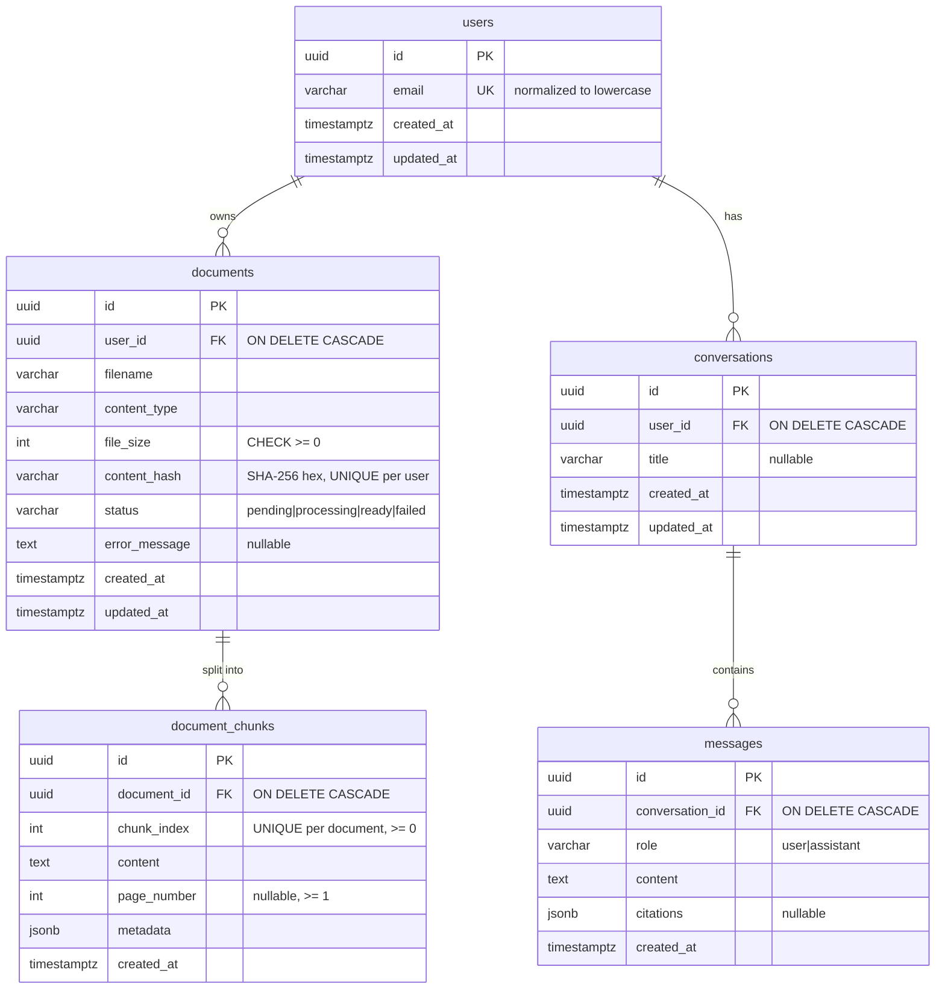

# DocMind

Upload PDF/DOCX/TXT documents, then run semantic search and RAG answers with validated citations.
Work in progress.

- **Phase 1 (done):** FastAPI skeleton, config, liveness endpoint, error envelope, tests.
- **Phase 2 (done):** PostgreSQL (Docker Compose), SQLAlchemy 2.x models, Alembic migrations,
  database readiness endpoint, PostgreSQL integration tests.
- **Phase 3 (done):** document upload (PDF/DOCX/TXT), validation, text extraction,
  metadata persistence, duplicate detection.

## Quick start (Windows PowerShell)

```powershell
python -m venv .venv
.\.venv\Scripts\Activate.ps1
pip install -e ".[dev]"

Copy-Item .env.example .env        # then edit POSTGRES_PASSWORD and DOCMIND_DATABASE_URL
docker compose up -d postgres      # wait until STATUS shows "healthy": docker compose ps
alembic upgrade head               # create the schema
uvicorn app.main:app --reload      # WinError 10013 = port busy: add --port 8001 and use it below
# http://127.0.0.1:8000/api/v1/health        liveness  (never touches the DB)
# http://127.0.0.1:8000/api/v1/health/ready  readiness (checks the DB, 503 if unreachable)
```

## Environment variables

App settings use the `DOCMIND_` prefix and are read from the environment or `.env`
(`app/core/config.py`). `.env` is git-ignored; `.env.example` contains placeholders only.

| Variable | Default | Purpose |
|---|---|---|
| `DOCMIND_ENVIRONMENT` | `dev` | `dev` / `test` / `prod` |
| `DOCMIND_DEBUG` | `false` | FastAPI debug mode |
| `DOCMIND_LOG_LEVEL` | `INFO` | Log level |
| `DOCMIND_DATABASE_URL` | local dev URL | SQLAlchemy URL, must use `postgresql+psycopg://` |
| `DOCMIND_DB_POOL_SIZE` | `5` | Persistent pooled connections per process |
| `DOCMIND_DB_MAX_OVERFLOW` | `5` | Extra connections allowed under load |
| `DOCMIND_DB_POOL_TIMEOUT_S` | `5` | Max wait for a free pooled connection |
| `DOCMIND_DB_CONNECT_TIMEOUT_S` | `3` | TCP/auth connect timeout |
| `DOCMIND_DB_READINESS_TIMEOUT_MS` | `2000` | `statement_timeout` for the readiness query |
| `DOCMIND_STORAGE_DIR` | `~/.docmind/storage` | Where uploaded originals are stored (outside the repo) |
| `DOCMIND_MAX_UPLOAD_BYTES` | `10485760` (10 MiB) | Maximum file size |
| `DOCMIND_MAX_PDF_PAGES` | `2000` | PDFs with more pages are rejected |
| `DOCMIND_MAX_DOCX_UNCOMPRESSED_BYTES` | `52428800` (50 MiB) | Zip-bomb guard for DOCX archives |
| `DOCMIND_DEV_USER_EMAIL` | `dev@docmind.local` | Development-only owner of uploads (see below) |
| `DOCMIND_TEST_DATABASE_URL` | unset | Enables integration tests; DB name must end in `_test` |
| `POSTGRES_USER` / `POSTGRES_PASSWORD` / `POSTGRES_DB` / `POSTGRES_PORT` | — | Used by Docker Compose only |

The database URL is stored as a `SecretStr`, so the password does not show up in
`repr(settings)`, logs, or tracebacks.

## Database

### Start PostgreSQL

```powershell
docker compose up -d postgres
docker compose ps                  # wait for "healthy"
docker compose logs postgres       # if it is not healthy
```

The image is `pgvector/pgvector:pg17`. The `vector` extension is **not** enabled yet; that will
be an explicit migration in Phase 4. Data lives in the named volume `docmind_pgdata`, so
`docker compose down` keeps it and `docker compose down -v` deletes it. On the first start with
an empty volume, `docker/postgres/init/01-create-test-db.sql` creates the `docmind_test` database.

### Apply migrations

The schema is created only by Alembic, never by `Base.metadata.create_all()` at app startup.
That way every environment's schema has a versioned, reviewable history.
`alembic/env.py` reads the URL from `DOCMIND_DATABASE_URL` / `.env`, so the URL is never
stored in `alembic.ini`.

```powershell
alembic upgrade head               # apply all migrations
alembic current                    # revision the database is at
alembic history --verbose          # all revisions
alembic downgrade -1               # undo the last migration
alembic downgrade base             # undo everything (drops all app tables)
alembic upgrade head --sql         # print the SQL without running it (offline mode)
```

### Future migrations (workflow)

```powershell
# 1. Change a model in app/models/
# 2. Generate a migration by diffing the models against the live database
alembic revision --autogenerate -m "add storage_key to documents"
# 3. READ the generated file in alembic/versions/ and fix it by hand if needed
#    (autogenerate misses renames, CHECK constraint changes, data migrations, extensions)
# 4. Apply it and check that the models and the database match again
alembic upgrade head
alembic check                      # "No new upgrade operations detected." means in sync
```

Constraint names are deterministic (a naming convention in `app/models/base.py`, for example
`uq_users_email`), so later migrations can drop or alter constraints by name.

### Inspect the schema

```powershell
docker compose exec postgres psql -U docmind -d docmind -c "\dt"
docker compose exec postgres psql -U docmind -d docmind -c "\d+ documents"
docker compose exec postgres psql -U docmind -d docmind -c "SELECT * FROM alembic_version"
```

### Schema



Design notes:

- **Deleting** a user removes all of their data. The cascade is enforced by PostgreSQL
  (`ON DELETE CASCADE`), not only by the ORM, so it also applies to raw SQL. File bytes are never
  stored in PostgreSQL; removing stored files on delete is the service layer's job (Phase 3).
- **Statuses and roles** are `VARCHAR` + `CHECK` rather than native PostgreSQL `ENUM`s. Adding a
  value later is a simple constraint swap in a migration.
- **Citations** are JSON snapshots, not foreign keys, so an answer stays readable after its
  source document is deleted.
- **Timestamps** are `timestamptz` with `DEFAULT now()`. `updated_at` is refreshed by the ORM on
  updates; raw SQL `UPDATE`s must set it themselves.

## Documents API

### Upload a document

`POST /api/v1/documents`: multipart form with one field, `file` (PDF, DOCX or TXT).

```powershell
# Windows PowerShell 5.1: use curl.exe (bundled with Windows 10+), not the "curl" alias
curl.exe -s -F "file=@C:\path\to\report.pdf" http://127.0.0.1:8000/api/v1/documents

# PowerShell 7+ alternative
Invoke-RestMethod -Method Post -Uri http://127.0.0.1:8000/api/v1/documents `
  -Form @{ file = Get-Item C:\path\to\report.pdf }
```

Response `201 Created` (a real response for a generated 3-page sample PDF):

```json
{
  "document": {
    "id": "7fa9352e-f071-4c98-bac4-8c97407e3e4b",
    "filename": "report.pdf",
    "content_type": "application/pdf",
    "file_size": 1618,
    "content_hash": "ecafe280634d0ec1fc7645ed9a871533a589835555f0776fca07d7c2d34e538c",
    "status": "pending",
    "error_message": null,
    "created_at": "2026-10-24T17:14:01.784519Z",
    "updated_at": "2026-10-24T17:14:01.784519Z"
  },
  "extraction": { "page_count": 3, "pages_with_text": 3, "character_count": 102 }
}
```

Uploading the same file again returns `409`:

```json
{"error": {"code": "duplicate_document", "message": "This file has already been uploaded.",
           "details": {"document_id": "7fa9352e-f071-4c98-bac4-8c97407e3e4b"}}}
```

`status` stays `pending` until indexing exists (Phase 4). `extraction` is computed during the
upload and is not stored.

### Errors

All errors use the standard envelope `{"error": {"code", "message", "details"}}`.

| HTTP | `code` | When |
|---|---|---|
| 400 | `empty_file` | Zero-byte file |
| 401 | `authentication_required` | `DOCMIND_ENVIRONMENT=prod` (no auth yet, see below) |
| 409 | `duplicate_document` | Same bytes already uploaded by this user; `details.document_id` is the existing one |
| 413 | `payload_too_large` | Request body over the limit, rejected while streaming |
| 413 | `file_too_large` | File over `DOCMIND_MAX_UPLOAD_BYTES` |
| 415 | `unsupported_file_type` | Extension is not `.pdf`, `.docx` or `.txt` |
| 415 | `content_type_mismatch` | Declared `Content-Type` contradicts the extension |
| 422 | `invalid_file_content` | Bytes don't match the extension (e.g. DOCX renamed to `.pdf`), binary "text", legacy `.doc` |
| 422 | `corrupt_file` | Damaged PDF/DOCX |
| 422 | `encrypted_document` | Password-protected PDF |
| 422 | `no_text_extracted` | No text layer (scanned PDF: OCR is out of scope) or only whitespace |
| 422 | `unsupported_text_encoding` | TXT that is not UTF-8 / UTF-16 with BOM (e.g. cp1251) |
| 422 | `too_many_pages` / `archive_too_large` | Resource limits (PDF pages, DOCX uncompressed size) |
| 422 | `validation_error` | No `file` field in the form |

### How an upload is processed

1. **Size cap while streaming.** An ASGI middleware rejects the request as soon as the body
   exceeds `max_upload_bytes` + 64 KiB of multipart overhead (Content-Length or streamed byte
   count). This matters because Starlette spools multipart files to disk *before* the endpoint
   runs, so a check inside the endpoint alone would not protect the server.
2. **Bounded copy** of the file into `storage_dir/tmp/<random>.part`, in 1 MiB chunks, computing
   SHA-256 on the way and stopping at exactly `max_upload_bytes`.
3. **Type checks.** The extension must be allowed, a declared `Content-Type` must not contradict
   it (`application/octet-stream` is accepted, since it says nothing), and the magic bytes
   must match. The client's MIME type and filename are never trusted on their own. Passing
   these checks does **not** mean a file is safe; it only selects the parser.
4. **Duplicate check** by `(user_id, content_hash)` before parsing. A concurrent duplicate that
   slips past it is caught by the unique constraint and also returns 409.
5. **Text extraction and normalization** (validation step): PyMuPDF for PDF (per page), python-docx
   for DOCX (paragraphs and tables in document order), strict UTF-8/UTF-16 decoding for TXT.
   The text is normalized to NFC, `\n` line endings, single spaces, at most one blank line between
   paragraphs, with control and zero-width characters removed.
6. **Persist.** Insert the row (flush), atomically move the file to `storage_dir/documents/<uuid>`,
   then commit. If the commit fails, the file is deleted. A crash between the move and the
   commit can leave an orphaned file, but never a row pointing to a missing file.

**Storage decision.** The original file is kept on disk and only metadata goes to PostgreSQL
(never file bytes). The original is the source of truth: Phase 4 re-extracts from it for chunking,
and a better parser or normalizer can be applied later without asking users to upload again.
Extracted text is not persisted in Phase 3, so no schema change was needed. On-disk names come
only from server-generated UUIDs; the client filename is sanitized and stored for display only.

**User identity (development only).** Authentication arrives in Phase 8. Until then, every
upload belongs to one user, `DOCMIND_DEV_USER_EMAIL`, created on first use. With
`DOCMIND_ENVIRONMENT=prod`, document endpoints return 401 instead of sharing that account.

**Logging.** Logs contain the document id, user id, type, size and rejection codes only. They
never contain filenames, document text or server paths.

## Tests

```powershell
pytest -v                # unit tests; integration tests are SKIPPED without a test DB
ruff check .
```

To run the PostgreSQL integration tests (models, constraints, cascades, migrations, readiness):

```powershell
docker compose up -d postgres
# Same server and credentials as DOCMIND_DATABASE_URL in .env, but the docmind_test database:
$env:DOCMIND_TEST_DATABASE_URL = ((Get-Content .env | Select-String '^DOCMIND_DATABASE_URL=').Line -replace '^DOCMIND_DATABASE_URL=','').Trim() -replace '/docmind$','/docmind_test'
pytest -v                # everything
pytest -m integration -v # only PostgreSQL tests
Remove-Item Env:DOCMIND_TEST_DATABASE_URL
```

How test isolation works:

- The test database name must end in `_test`, otherwise the run aborts. The suite drops and
  recreates its `public` schema.
- The schema is built with `alembic upgrade head`, so every test run also tests the migrations.
  A drift test (`compare_metadata`) fails if a model changed without a matching migration.
- Each test runs in a transaction that is rolled back, so tests don't share rows. Upload tests
  go through the real app, which commits, so they truncate the tables before and after each test
  and use a temporary storage directory.
- PDF and DOCX samples are generated in memory (`tests/samples.py`); no binary fixtures are
  committed. PDF samples are ASCII-only (the built-in PDF fonts only cover Latin-1), so
  Kazakh and Russian extraction is tested through DOCX and TXT.

Why PostgreSQL rather than SQLite for these tests: the schema uses JSONB, `timestamptz`,
`ON DELETE CASCADE`, and CHECK constraints. SQLite handles several of these differently (for
example, foreign keys are off unless enabled per connection, and it has no JSONB), so passing on
SQLite would not prove the PostgreSQL schema works.

## Limitations (current phase)

- No chunking, embeddings, search, RAG, or authentication yet. `users` has no password
  column; authentication arrives in Phase 8. All uploads belong to the development user.
- No endpoints yet to list, fetch or delete documents.
- Text is extracted inside the request (in FastAPI's threadpool). A 10 MiB PDF takes a while to
  parse; Phase 4 moves heavy indexing work to a background worker.
- Extracted text is not stored yet; Phase 4 re-extracts it from the stored original.
- Files are stored on the local disk of one machine. Orphaned files (after a crash between the
  file move and the commit) are not cleaned up automatically.
- PDF hard line breaks inside paragraphs are kept as single `\n`; text is not reflowed.
  Multi-column layouts follow the PDF's content order, which can interleave columns.
- PyMuPDF is AGPL-3.0 licensed. That matters if DocMind is ever distributed or offered as a
  closed-source network service.
- Ownership isolation exists in the schema (`user_id` foreign keys) but is not enforced by any
  API yet.
- Email uniqueness is case-insensitive only through ORM normalization. Raw SQL inserts bypass it.
- The readiness endpoint checks database connectivity only. It does not check that migrations
  are at `head`.
