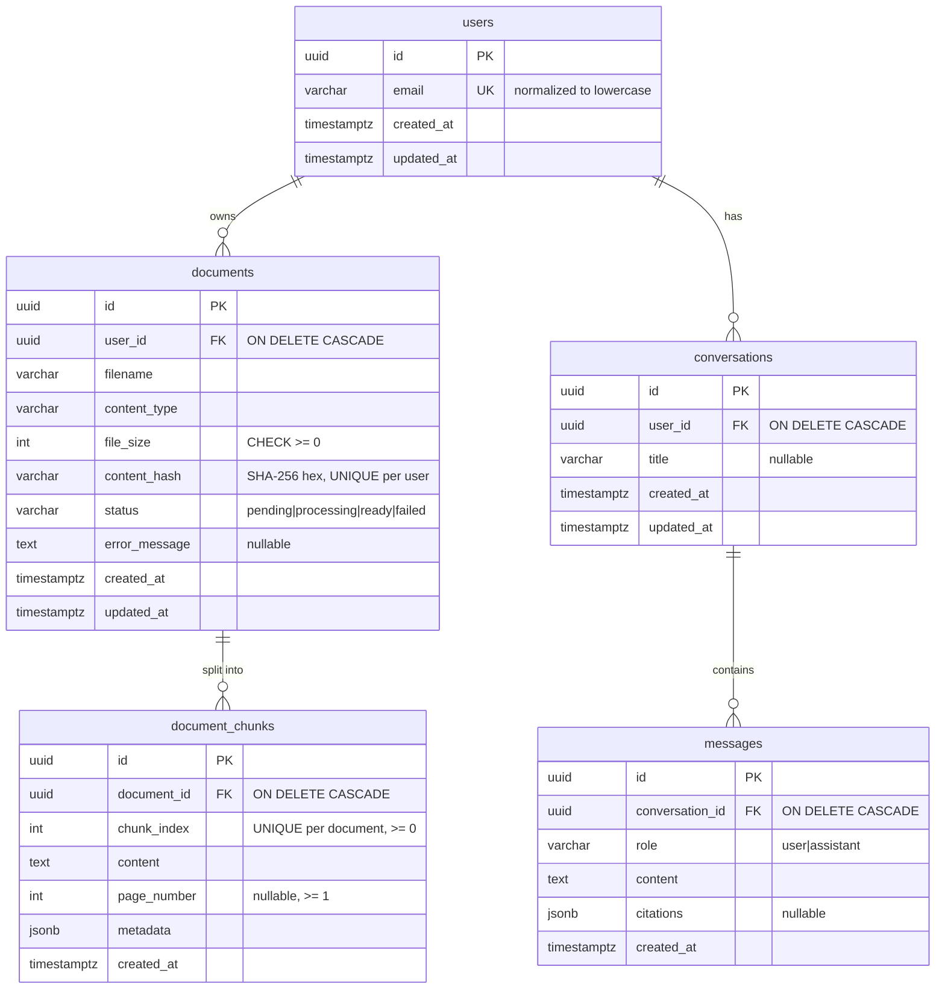

# DocMind

Upload PDF/DOCX/TXT documents, then run semantic search and RAG answers with validated citations.
Work in progress.

- **Phase 1 (done):** FastAPI skeleton, config, liveness endpoint, error envelope, tests.
- **Phase 2 (done):** PostgreSQL (Docker Compose), SQLAlchemy 2.x models, Alembic migrations,
  database readiness endpoint, PostgreSQL integration tests.

## Quick start (Windows PowerShell)

```powershell
python -m venv .venv
.\.venv\Scripts\Activate.ps1
pip install -e ".[dev]"

Copy-Item .env.example .env        # then edit POSTGRES_PASSWORD and DOCMIND_DATABASE_URL
docker compose up -d postgres      # wait until STATUS shows "healthy": docker compose ps
alembic upgrade head               # create the schema
uvicorn app.main:app --reload      # WinError 10013 = port busy: add --port 8001 and use it below
# http://127.0.0.1:8000/api/v1/health        liveness  (never touches the DB)
# http://127.0.0.1:8000/api/v1/health/ready  readiness (checks the DB, 503 if unreachable)
```

## Environment variables

App settings use the `DOCMIND_` prefix and are read from the environment or `.env`
(`app/core/config.py`). `.env` is git-ignored; `.env.example` contains placeholders only.

| Variable | Default | Purpose |
|---|---|---|
| `DOCMIND_ENVIRONMENT` | `dev` | `dev` / `test` / `prod` |
| `DOCMIND_DEBUG` | `false` | FastAPI debug mode |
| `DOCMIND_LOG_LEVEL` | `INFO` | Log level |
| `DOCMIND_DATABASE_URL` | local dev URL | SQLAlchemy URL, must use `postgresql+psycopg://` |
| `DOCMIND_DB_POOL_SIZE` | `5` | Persistent pooled connections per process |
| `DOCMIND_DB_MAX_OVERFLOW` | `5` | Extra connections allowed under load |
| `DOCMIND_DB_POOL_TIMEOUT_S` | `5` | Max wait for a free pooled connection |
| `DOCMIND_DB_CONNECT_TIMEOUT_S` | `3` | TCP/auth connect timeout |
| `DOCMIND_DB_READINESS_TIMEOUT_MS` | `2000` | `statement_timeout` for the readiness query |
| `DOCMIND_TEST_DATABASE_URL` | unset | Enables integration tests; DB name must end in `_test` |
| `POSTGRES_USER` / `POSTGRES_PASSWORD` / `POSTGRES_DB` / `POSTGRES_PORT` | — | Used by Docker Compose only |

The database URL is stored as a `SecretStr`, so the password does not show up in
`repr(settings)`, logs, or tracebacks.

## Database

### Start PostgreSQL

```powershell
docker compose up -d postgres
docker compose ps                  # wait for "healthy"
docker compose logs postgres       # if it is not healthy
```

The image is `pgvector/pgvector:pg17`. The `vector` extension is **not** enabled yet; that will
be an explicit migration in Phase 4. Data lives in the named volume `docmind_pgdata`, so
`docker compose down` keeps it and `docker compose down -v` deletes it. On the first start with
an empty volume, `docker/postgres/init/01-create-test-db.sql` creates the `docmind_test` database.

### Apply migrations

The schema is created only by Alembic, never by `Base.metadata.create_all()` at app startup.
That way every environment's schema has a versioned, reviewable history.
`alembic/env.py` reads the URL from `DOCMIND_DATABASE_URL` / `.env`, so the URL is never
stored in `alembic.ini`.

```powershell
alembic upgrade head               # apply all migrations
alembic current                    # revision the database is at
alembic history --verbose          # all revisions
alembic downgrade -1               # undo the last migration
alembic downgrade base             # undo everything (drops all app tables)
alembic upgrade head --sql         # print the SQL without running it (offline mode)
```

### Future migrations (workflow)

```powershell
# 1. Change a model in app/models/
# 2. Generate a migration by diffing the models against the live database
alembic revision --autogenerate -m "add storage_key to documents"
# 3. READ the generated file in alembic/versions/ and fix it by hand if needed
#    (autogenerate misses renames, CHECK constraint changes, data migrations, extensions)
# 4. Apply it and check that the models and the database match again
alembic upgrade head
alembic check                      # "No new upgrade operations detected." means in sync
```

Constraint names are deterministic (a naming convention in `app/models/base.py`, for example
`uq_users_email`), so later migrations can drop or alter constraints by name.

### Inspect the schema

```powershell
docker compose exec postgres psql -U docmind -d docmind -c "\dt"
docker compose exec postgres psql -U docmind -d docmind -c "\d+ documents"
docker compose exec postgres psql -U docmind -d docmind -c "SELECT * FROM alembic_version"
```

### Schema



Design notes:

- **Deleting** a user removes all of their data. The cascade is enforced by PostgreSQL
  (`ON DELETE CASCADE`), not only by the ORM, so it also applies to raw SQL. File bytes are never
  stored in PostgreSQL; removing stored files on delete is the service layer's job (Phase 3).
- **Statuses and roles** are `VARCHAR` + `CHECK` rather than native PostgreSQL `ENUM`s. Adding a
  value later is a simple constraint swap in a migration.
- **Citations** are JSON snapshots, not foreign keys, so an answer stays readable after its
  source document is deleted.
- **Timestamps** are `timestamptz` with `DEFAULT now()`. `updated_at` is refreshed by the ORM on
  updates; raw SQL `UPDATE`s must set it themselves.

## Tests

```powershell
pytest -v                # unit tests; integration tests are SKIPPED without a test DB
ruff check .
```

To run the PostgreSQL integration tests (models, constraints, cascades, migrations, readiness):

```powershell
docker compose up -d postgres
# Same server and credentials as DOCMIND_DATABASE_URL in .env, but the docmind_test database:
$env:DOCMIND_TEST_DATABASE_URL = ((Get-Content .env | Select-String '^DOCMIND_DATABASE_URL=').Line -replace '^DOCMIND_DATABASE_URL=','').Trim() -replace '/docmind$','/docmind_test'
pytest -v                # everything
pytest -m integration -v # only PostgreSQL tests
Remove-Item Env:DOCMIND_TEST_DATABASE_URL
```

How test isolation works:

- The test database name must end in `_test`, otherwise the run aborts. The suite drops and
  recreates its `public` schema.
- The schema is built with `alembic upgrade head`, so every test run also tests the migrations.
  A drift test (`compare_metadata`) fails if a model changed without a matching migration.
- Each test runs in a transaction that is rolled back, so tests don't share rows.

Why PostgreSQL rather than SQLite for these tests: the schema uses JSONB, `timestamptz`,
`ON DELETE CASCADE`, and CHECK constraints. SQLite handles several of these differently (for
example, foreign keys are off unless enabled per connection, and it has no JSONB), so passing on
SQLite would not prove the PostgreSQL schema works.

## Limitations (current phase)

- No uploads, parsing, embeddings, search, RAG, or authentication yet. `users` has no password
  column; authentication arrives in Phase 8.
- Ownership isolation exists in the schema (`user_id` foreign keys) but is not enforced by any
  API yet.
- Email uniqueness is case-insensitive only through ORM normalization. Raw SQL inserts bypass it.
- The readiness endpoint checks database connectivity only. It does not check that migrations
  are at `head`.
