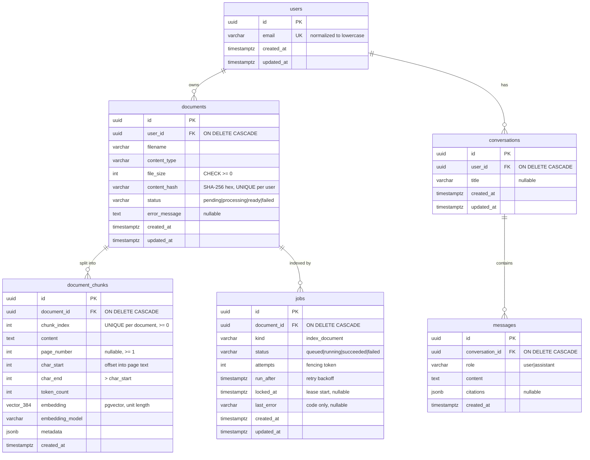
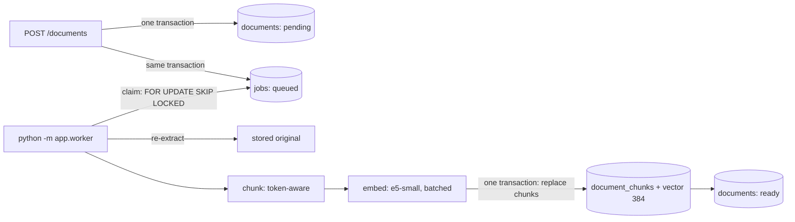

# DocMind

Upload PDF/DOCX/TXT documents, then run semantic search and RAG answers with validated citations.
Work in progress.

- **Phase 1 (done):** FastAPI skeleton, config, liveness endpoint, error envelope, tests.
- **Phase 2 (done):** PostgreSQL (Docker Compose), SQLAlchemy 2.x models, Alembic migrations,
  database readiness endpoint, PostgreSQL integration tests.
- **Phase 3 (done):** document upload (PDF/DOCX/TXT), validation, text extraction,
  metadata persistence, duplicate detection.
- **Phase 4 (done):** token-aware chunking, local multilingual embeddings, pgvector storage,
  background indexing worker on a PostgreSQL job queue, indexing status and retries.
- **Phase 5 (in progress):** semantic search API (`POST /api/v1/search`) is done; the
  labeled retrieval evaluation (Recall@k, Precision@k, MRR) is still to do.

## Quick start (Windows PowerShell)

```powershell
python -m venv .venv
.\.venv\Scripts\Activate.ps1
pip install -e ".[dev,embeddings]"   # "embeddings" = sentence-transformers + PyTorch (worker)

Copy-Item .env.example .env        # then edit POSTGRES_PASSWORD and DOCMIND_DATABASE_URL
docker compose up -d postgres      # wait until STATUS shows "healthy": docker compose ps
alembic upgrade head               # create the schema (also enables pgvector)
uvicorn app.main:app --reload      # WinError 10013 = port busy: add --port 8001 and use it below
# http://127.0.0.1:8000/api/v1/health        liveness  (never touches the DB)
# http://127.0.0.1:8000/api/v1/health/ready  readiness (checks the DB, 503 if unreachable)

# In a second terminal (same venv): the indexing worker. The first start downloads the model.
python -m app.worker
```

## Environment variables

App settings use the `DOCMIND_` prefix and are read from the environment or `.env`
(`app/core/config.py`). `.env` is git-ignored; `.env.example` contains placeholders only.

| Variable | Default | Purpose |
|---|---|---|
| `DOCMIND_ENVIRONMENT` | `dev` | `dev` / `test` / `prod` |
| `DOCMIND_DEBUG` | `false` | FastAPI debug mode |
| `DOCMIND_LOG_LEVEL` | `INFO` | Log level |
| `DOCMIND_DATABASE_URL` | local dev URL | SQLAlchemy URL, must use `postgresql+psycopg://` |
| `DOCMIND_DB_POOL_SIZE` | `5` | Persistent pooled connections per process |
| `DOCMIND_DB_MAX_OVERFLOW` | `5` | Extra connections allowed under load |
| `DOCMIND_DB_POOL_TIMEOUT_S` | `5` | Max wait for a free pooled connection |
| `DOCMIND_DB_CONNECT_TIMEOUT_S` | `3` | TCP/auth connect timeout |
| `DOCMIND_DB_READINESS_TIMEOUT_MS` | `2000` | `statement_timeout` for the readiness query |
| `DOCMIND_STORAGE_DIR` | `~/.docmind/storage` | Where uploaded originals are stored (outside the repo) |
| `DOCMIND_MAX_UPLOAD_BYTES` | `10485760` (10 MiB) | Maximum file size |
| `DOCMIND_MAX_PDF_PAGES` | `2000` | PDFs with more pages are rejected |
| `DOCMIND_MAX_DOCX_UNCOMPRESSED_BYTES` | `52428800` (50 MiB) | Zip-bomb guard for DOCX archives |
| `DOCMIND_DEV_USER_EMAIL` | `dev@docmind.local` | Development-only owner of uploads (see below) |
| `DOCMIND_EMBEDDING_BACKEND` | `sentence-transformers` | `fake` = deterministic, meaningless vectors (tests/CI; refused in prod) |
| `DOCMIND_EMBEDDING_MODEL` | `intfloat/multilingual-e5-small` | Must be listed in `app/embeddings/base.py` (`KNOWN_MODELS`) |
| `DOCMIND_EMBEDDING_DEVICE` | unset (auto) | e.g. `cpu`, `cuda`; unset lets sentence-transformers choose |
| `DOCMIND_EMBEDDING_BATCH_SIZE` | `32` | Chunks per model call (1..256); bounds peak memory |
| `DOCMIND_EMBEDDING_CACHE_DIR` | unset | Model cache; unset = Hugging Face default (`~/.cache/huggingface`) |
| `DOCMIND_EMBEDDING_ALLOW_DOWNLOAD` | `true` | `false` = use only an already cached model (offline) |
| `DOCMIND_CHUNK_SIZE_TOKENS` | `256` | Max tokens per chunk (model tokenizer); must fit the model input |
| `DOCMIND_CHUNK_OVERLAP_TOKENS` | `32` | Max tokens repeated from the previous chunk; must be < chunk size |
| `DOCMIND_MAX_CHUNKS_PER_DOCUMENT` | `20000` | Larger documents fail with `too_many_chunks` (memory bound) |
| `DOCMIND_SEARCH_TIMEOUT_MS` | `5000` | `statement_timeout` for the search query; exceeded = 503 |
| `DOCMIND_WORKER_POLL_INTERVAL_S` | `2` | Worker sleep when the queue is empty |
| `DOCMIND_JOB_LEASE_TIMEOUT_S` | `1800` | A `running` job older than this is assumed abandoned and reclaimed |
| `DOCMIND_JOB_MAX_ATTEMPTS` | `3` | Attempts before a document is marked `failed` |
| `DOCMIND_JOB_RETRY_DELAY_S` | `30` | Retry *n* waits *n* x this |
| `DOCMIND_TEST_DATABASE_URL` | unset | Enables integration tests; DB name must end in `_test` |
| `POSTGRES_USER` / `POSTGRES_PASSWORD` / `POSTGRES_DB` / `POSTGRES_PORT` | — | Used by Docker Compose only |

The database URL is stored as a `SecretStr`, so the password does not show up in
`repr(settings)`, logs, or tracebacks.

## Database

### Start PostgreSQL

```powershell
docker compose up -d postgres
docker compose ps                  # wait for "healthy"
docker compose logs postgres       # if it is not healthy
```

The image is `pgvector/pgvector:pg17` (it ships pgvector 0.8.7). The `vector` extension is
enabled by Alembic revision `76cdab7f68eb` (`CREATE EXTENSION IF NOT EXISTS vector`), which needs
a role allowed to create extensions; the Compose superuser is. On a managed database, enable the
extension once as an administrator before `alembic upgrade head`. Data lives in the named volume `docmind_pgdata`, so
`docker compose down` keeps it and `docker compose down -v` deletes it. On the first start with
an empty volume, `docker/postgres/init/01-create-test-db.sql` creates the `docmind_test` database.

### Apply migrations

The schema is created only by Alembic, never by `Base.metadata.create_all()` at app startup.
That way every environment's schema has a versioned, reviewable history.
`alembic/env.py` reads the URL from `DOCMIND_DATABASE_URL` / `.env`, so the URL is never
stored in `alembic.ini`.

```powershell
alembic upgrade head               # apply all migrations
alembic current                    # revision the database is at
alembic history --verbose          # all revisions
alembic downgrade -1               # undo the last migration
alembic downgrade base             # undo everything (drops all app tables)
alembic upgrade head --sql         # print the SQL without running it (offline mode)
```

### Future migrations (workflow)

```powershell
# 1. Change a model in app/models/
# 2. Generate a migration by diffing the models against the live database
alembic revision --autogenerate -m "add storage_key to documents"
# 3. READ the generated file in alembic/versions/ and fix it by hand if needed
#    (autogenerate misses renames, CHECK constraint changes, data migrations, extensions)
# 4. Apply it and check that the models and the database match again
alembic upgrade head
alembic check                      # "No new upgrade operations detected." means in sync
```

Constraint names are deterministic (a naming convention in `app/models/base.py`, for example
`uq_users_email`), so later migrations can drop or alter constraints by name.

### Inspect the schema

```powershell
docker compose exec postgres psql -U docmind -d docmind -c "\dt"
docker compose exec postgres psql -U docmind -d docmind -c "\d+ documents"
docker compose exec postgres psql -U docmind -d docmind -c "SELECT * FROM alembic_version"
```

### Schema



Design notes:

- **Deleting** a user removes all of their data. The cascade is enforced by PostgreSQL
  (`ON DELETE CASCADE`), not only by the ORM, so it also applies to raw SQL. File bytes are never
  stored in PostgreSQL; removing stored files on delete is the service layer's job (Phase 3).
- **Statuses and roles** are `VARCHAR` + `CHECK` rather than native PostgreSQL `ENUM`s. Adding a
  value later is a simple constraint swap in a migration.
- **Citations** are JSON snapshots, not foreign keys, so an answer stays readable after its
  source document is deleted.
- **Timestamps** are `timestamptz` with `DEFAULT now()`. `updated_at` is refreshed by the ORM on
  updates; raw SQL `UPDATE`s must set it themselves.

## Documents API

### Upload a document

`POST /api/v1/documents`: multipart form with one field, `file` (PDF, DOCX or TXT).

```powershell
# Windows PowerShell 5.1: use curl.exe (bundled with Windows 10+), not the "curl" alias
curl.exe -s -F "file=@C:\path\to\report.pdf" http://127.0.0.1:8000/api/v1/documents

# PowerShell 7+ alternative
Invoke-RestMethod -Method Post -Uri http://127.0.0.1:8000/api/v1/documents `
  -Form @{ file = Get-Item C:\path\to\report.pdf }
```

Response `201 Created` (a real response for a generated 3-page sample PDF):

```json
{
  "document": {
    "id": "7fa9352e-f071-4c98-bac4-8c97407e3e4b",
    "filename": "report.pdf",
    "content_type": "application/pdf",
    "file_size": 1618,
    "content_hash": "ecafe280634d0ec1fc7645ed9a871533a589835555f0776fca07d7c2d34e538c",
    "status": "pending",
    "error_message": null,
    "created_at": "2026-10-24T17:14:01.784519Z",
    "updated_at": "2026-10-24T17:14:01.784519Z"
  },
  "extraction": { "page_count": 3, "pages_with_text": 3, "character_count": 102 }
}
```

Uploading the same file again returns `409`:

```json
{"error": {"code": "duplicate_document", "message": "This file has already been uploaded.",
           "details": {"document_id": "7fa9352e-f071-4c98-bac4-8c97407e3e4b"}}}
```

`status` is `pending` until the indexing worker picks the document up (see
[Indexing](#indexing-chunking-and-embeddings)). `extraction` is computed during the upload and is
not stored.

### Errors

All errors use the standard envelope `{"error": {"code", "message", "details"}}`.

| HTTP | `code` | When |
|---|---|---|
| 400 | `empty_file` | Zero-byte file |
| 401 | `authentication_required` | `DOCMIND_ENVIRONMENT=prod` (no auth yet, see below) |
| 409 | `duplicate_document` | Same bytes already uploaded by this user; `details.document_id` is the existing one |
| 413 | `payload_too_large` | Request body over the limit, rejected while streaming |
| 413 | `file_too_large` | File over `DOCMIND_MAX_UPLOAD_BYTES` |
| 415 | `unsupported_file_type` | Extension is not `.pdf`, `.docx` or `.txt` |
| 415 | `content_type_mismatch` | Declared `Content-Type` contradicts the extension |
| 422 | `invalid_file_content` | Bytes don't match the extension (e.g. DOCX renamed to `.pdf`), binary "text", legacy `.doc` |
| 422 | `corrupt_file` | Damaged PDF/DOCX |
| 422 | `encrypted_document` | Password-protected PDF |
| 422 | `no_text_extracted` | No text layer (scanned PDF: OCR is out of scope) or only whitespace |
| 422 | `unsupported_text_encoding` | TXT that is not UTF-8 / UTF-16 with BOM (e.g. cp1251) |
| 422 | `too_many_pages` / `archive_too_large` | Resource limits (PDF pages, DOCX uncompressed size) |
| 422 | `validation_error` | No `file` field in the form |

### How an upload is processed

1. **Size cap while streaming.** An ASGI middleware rejects the request as soon as the body
   exceeds `max_upload_bytes` + 64 KiB of multipart overhead (Content-Length or streamed byte
   count). This matters because Starlette spools multipart files to disk *before* the endpoint
   runs, so a check inside the endpoint alone would not protect the server.
2. **Bounded copy** of the file into `storage_dir/tmp/<random>.part`, in 1 MiB chunks, computing
   SHA-256 on the way and stopping at exactly `max_upload_bytes`.
3. **Type checks.** The extension must be allowed, a declared `Content-Type` must not contradict
   it (`application/octet-stream` is accepted, since it says nothing), and the magic bytes
   must match. The client's MIME type and filename are never trusted on their own. Passing
   these checks does **not** mean a file is safe; it only selects the parser.
4. **Duplicate check** by `(user_id, content_hash)` before parsing. A concurrent duplicate that
   slips past it is caught by the unique constraint and also returns 409.
5. **Text extraction and normalization** (validation step): PyMuPDF for PDF (per page), python-docx
   for DOCX (paragraphs and tables in document order), strict UTF-8/UTF-16 decoding for TXT.
   The text is normalized to NFC, `\n` line endings, single spaces, at most one blank line between
   paragraphs, with control and zero-width characters removed.
6. **Persist.** Insert the row (flush) and an `index_document` job in the same transaction,
   atomically move the file to `storage_dir/documents/<uuid>`, then commit. If the commit fails, the file is deleted. A crash between the move and the
   commit can leave an orphaned file, but never a row pointing to a missing file.

**Storage decision.** The original file is kept on disk and only metadata goes to PostgreSQL
(never file bytes). The original is the source of truth: the indexer re-extracts from it,
and a better parser or normalizer can be applied later without asking users to upload again.
Extracted text is not persisted in Phase 3, so no schema change was needed. On-disk names come
only from server-generated UUIDs; the client filename is sanitized and stored for display only.

**User identity (development only).** Authentication arrives in Phase 8. Until then, every
upload belongs to one user, `DOCMIND_DEV_USER_EMAIL`, created on first use. With
`DOCMIND_ENVIRONMENT=prod`, document endpoints return 401 instead of sharing that account.

**Logging.** Logs contain the document id, user id, type, size and rejection codes only. They
never contain filenames, document text or server paths.

## Indexing (chunking and embeddings)

Indexing runs in a **separate worker process**, never inside an HTTP request: embedding is
CPU-heavy and would block API workers. The queue is a PostgreSQL `jobs` table. A dedicated
broker (Redis, RabbitMQ) would add infrastructure without a need at this scale.



### Status lifecycle

| Document | Job | Meaning |
|---|---|---|
| `pending` | `queued` | Uploaded (or re-index requested), waiting for a worker |
| `processing` | `running` | A worker claimed it (`attempts` incremented, `locked_at` set) |
| `ready` | `succeeded` | All chunks and embeddings committed together |
| `pending` | `queued` | A retryable error happened; retry *n* runs after *n* x `JOB_RETRY_DELAY_S` |
| `failed` | `failed` | Permanent error, or `JOB_MAX_ATTEMPTS` used up; `error_message` is safe to show |

The existing `ready` status means "indexed"; no status values were added or renamed.

### Transactions and failure handling

1. **Claim** in a short transaction, committed at once, so the API sees `processing`.
2. **Extract, chunk, embed** with no transaction open. A connection is not held "idle in
   transaction" during minutes of CPU work.
3. **Write** in one transaction: lock the job, delete the document's old chunks, insert the new
   ones, mark the document `ready` and the job `succeeded`. Readers see the old chunk set or
   the new one, never a mix or a partial set.

- **Failures** are recorded in their own transaction. Retryable errors (database hiccup, model
  error) send the job back to `queued` and leave existing chunks untouched. Permanent errors
  (missing original, corrupt file, `too_many_chunks`) mark the document `failed` and delete
  its chunks, so nothing stale is left behind.
- **Crashed workers.** A job stuck in `running` longer than `JOB_LEASE_TIMEOUT_S` is reclaimed
  by any worker. If all attempts were used up, the document is marked `failed`.
- **Fencing.** The claim's attempt number is the worker's token. Before writing, the worker
  re-locks the job and checks that the number is unchanged. If its lease expired and another
  worker took over, the late result is discarded instead of overwriting newer work.
- **Duplicates.** A partial unique index allows only one `queued`/`running` job per document,
  so requesting a re-index twice is a no-op.
- **Lock order** is always job row, then document row, so the claim, write and re-index paths
  cannot deadlock each other.
- **Memory** is bounded by `MAX_CHUNKS_PER_DOCUMENT` (all chunks and vectors of one document
  are held until the final write) and by `EMBEDDING_BATCH_SIZE` per model call.

### Chunking (`app/ingestion/chunking.py`)

- Input is the normalized text from Phase 3 (NFC, `\n` line endings, at most one blank line
  between paragraphs). Offsets index that exact text: `content == page_text[char_start:char_end]`.
  Phase 7 relies on this to verify quoted citations.
- **Token-aware.** Sizes are counted with the embedding model's own tokenizer, so a chunk never
  exceeds the model's input. Silent truncation by the model would lose text.
  `chunk_size_tokens` is checked against the model limit when the worker starts. For
  multilingual-e5-small that limit is 508 passage tokens (512 minus 2 special tokens minus the
  `passage: ` prefix).
- **Structure first.** Text is split recursively: paragraphs, then lines, then sentences
  (`.!?…`, the same in English, Russian and Kazakh), then words, then a hard cut on token
  boundaries for text without spaces. A span is split further only while it is too large, so
  paragraphs that fit stay whole. The pieces are packed greedily up to `chunk_size_tokens`.
- **Overlap.** Each chunk starts with up to `chunk_overlap_tokens` from the end of the previous
  chunk, cut at the coarsest boundary that fits. Overlap gives way when the next piece would
  not fit beside it. Every chunk contains at least one piece its predecessor did not, which
  rules out infinite loops and duplicate chunks.
- **Pages.** Chunks never cross PDF page boundaries, so each chunk has exactly one
  `page_number` for citations. The cost is a smaller chunk at the end of some pages.
- Deterministic: the same text and settings always produce the same chunks.

### Embedding model

Default: **`intfloat/multilingual-e5-small`**: 384 dimensions, 512-token input,
XLM-RoBERTa-based multilingual model, runs on CPU. It needs the `query: ` / `passage: `
prefixes, which the embedder adds itself.

| | multilingual-e5-small (default) | BAAI/bge-m3 (candidate) |
|---|---|---|
| Dimensions | 384 | 1024 |
| Max input | 512 tokens | 8192 tokens |
| Size (model cards) | ~118M parameters | ~568M parameters |
| On this dev machine | Downloaded (~470 MB in the HF cache); runs on CPU | Not downloaded or tested |

Why the small model now: it keeps the default setup CPU-only and quick to download, and its
vectors take about a third of the storage of bge-m3's. bge-m3 accepts much longer inputs and is
the quality candidate. **The choice is provisional:** Phase 5 compares models on a labeled
English/Russian/Kazakh dataset (Recall@k, MRR). So far only integration sanity checks exist:
three hand-written cross-lingual pairs (EN↔RU, EN↔KK, RU↔EN) where the relevant passage scores
higher than an unrelated one. That is not a quality benchmark.

**Switching models** changes the vector size, so it requires: adding the model to
`KNOWN_MODELS`, a new migration that changes `document_chunks.embedding` to the new dimension
(and `EMBEDDING_DIMENSION`), then re-indexing every document. The worker refuses to start if the
configured model's dimension does not match the database. Each chunk also stores
`embedding_model`, so search can never compare vectors from different models.

**Validation.** Every batch is checked for the expected shape, NaN/infinite values and zero
vectors, then L2-normalized, so cosine similarity equals the dot product.

**Security.** Document text is passed to the tokenizer and the model as data only. Nothing in
it is executed or followed. Models load with `trust_remote_code=False`, so no Python code from
a model repository runs.

### Model download and cache

- The first worker start (or first real-model test) downloads the model through the
  Hugging Face Hub library into `DOCMIND_EMBEDDING_CACHE_DIR`, or by default
  `%USERPROFILE%\.cache\huggingface`. Later starts load it from the cache.
- `DOCMIND_EMBEDDING_ALLOW_DOWNLOAD=false` makes the worker fail instead of downloading. Use it
  for offline or production machines with a pre-filled cache.
- On Windows without Developer Mode, the library warns that symlinks are unsupported and stores
  files without deduplication. To silence it: `$env:HF_HUB_DISABLE_SYMLINKS_WARNING = "1"`.
- `pip install -e ".[embeddings]"` installs the CPU build of PyTorch from PyPI. A GPU needs a
  CUDA build of PyTorch that supports it (for example the `cu128` wheels from
  download.pytorch.org for RTX 50-series cards). This was **not** tested here, and e5-small
  works fine on CPU.

### Running the worker

```powershell
python -m app.worker                 # run until Ctrl+C; several workers may run in parallel
python -m app.worker --once          # process every runnable job, then exit
python -m app.worker reindex <document-uuid>   # queue a re-index (old chunks kept until replaced)

# Inspect indexing state
docker compose exec postgres psql -U docmind -d docmind -c "SELECT id, status, error_message FROM documents"
docker compose exec postgres psql -U docmind -d docmind -c "SELECT document_id, status, attempts, last_error FROM jobs"
docker compose exec postgres psql -U docmind -d docmind -c "SELECT document_id, count(*), max(token_count) FROM document_chunks GROUP BY 1"
```

Stopping with Ctrl+C mid-job leaves that job `running`. It is picked up again after
`DOCMIND_JOB_LEASE_TIMEOUT_S`, or sooner if you lower that value.

## Semantic search API

`POST /api/v1/search` embeds a natural-language query and returns the most similar passages
(chunks) of **your** indexed documents, best first.

Prerequisites: migrations at `head` (`alembic upgrade head`), at least one document uploaded
and indexed by the worker (status `ready`), and the `embeddings` extra installed in the API's
environment (`pip install -e ".[embeddings]"`). The API process loads the same model as the
worker on the **first** search request (a few seconds; the very first run may download it).
Without the extra, search returns `503 embedding_unavailable` and everything else still works.

```powershell
$body = @{ query = "When do I have to pay the invoice?"; top_k = 3 } | ConvertTo-Json
Invoke-RestMethod -Method Post -Uri http://127.0.0.1:8000/api/v1/search `
  -ContentType "application/json; charset=utf-8" `
  -Body ([System.Text.Encoding]::UTF8.GetBytes($body)) | ConvertTo-Json -Depth 5

# Only within some documents, and only results with cosine similarity >= 0.8
$body = @{ query = "payment terms"; document_ids = @("<document-uuid>"); min_similarity = 0.8 } | ConvertTo-Json
```

The UTF-8 byte encoding matters for Russian and Kazakh queries: Windows PowerShell 5.1 would
otherwise send the body in the local code page.

Request body:

| Field | Type | Default | Rules |
|---|---|---|---|
| `query` | string | required | Trimmed; 1 to 1000 characters |
| `top_k` | int | `5` | 1 to 20 |
| `document_ids` | list of UUIDs | all your documents | 1 to 50 ids; duplicates ignored; each must be yours |
| `min_similarity` | float | none | -1 to 1; drops results with lower cosine similarity |

Unknown fields are rejected (422), so a typo such as `topk` cannot be silently ignored.

Response `200` (real output of the default model, from a 3-paragraph test document indexed
with small 24-token chunks; the other two results are omitted here):

```json
{
  "results": [
    {
      "document_id": "6ff889f2-822c-4661-b478-57dd6ef07509",
      "filename": "contract.txt",
      "chunk_id": "18b33b01-78eb-4e73-b6b5-a2318811d543",
      "chunk_index": 0,
      "page_number": null,
      "char_start": 0,
      "char_end": 70,
      "content": "Payment is due within thirty days after the invoice has been received.",
      "similarity": 0.8438019249557317
    }
  ],
  "metric": "cosine",
  "embedding_model": "intfloat/multilingual-e5-small"
}
```

`page_number` is set for PDFs and `null` for TXT/DOCX. `char_start`/`char_end` locate the
passage in the normalized page text. No matching chunk returns `200` with `"results": []`,
including while documents are still being indexed.

### Similarity score

- **Metric:** cosine similarity = `1 - (embedding <=> query)` (pgvector cosine distance).
  Stored and query vectors are both L2-normalized, so it equals their dot product and lies
  in **[-1, 1]**. Higher is more similar.
- It is a **ranking signal, not a probability or a confidence**. Its scale depends on the
  model: e5 models place most text in a narrow high band. In the run above, all three
  passages scored 0.80 to 0.84, including unrelated ones. That is why `min_similarity` has no
  default. A useful threshold has to be measured on labeled data for a given model.
- Only chunks embedded by the **same model** as the query are searched (`embedding_model`
  column), with the same `query: `/`passage: ` prefixes and normalization as indexing. The
  API reuses one embedder instance per process.
- **Deterministic order:** by distance, then `document_id`, then `chunk_index` (a unique pair),
  so equal scores always come back in the same order.

### Errors

| HTTP | `code` | When |
|---|---|---|
| 401 | `authentication_required` | `DOCMIND_ENVIRONMENT=prod` (no auth yet) |
| 404 | `document_not_found` | An id in `document_ids` does not exist **or belongs to another user** (same answer, so ids of others' documents cannot be probed); `details.document_ids` lists them |
| 405 | `method_not_allowed` | `GET` (the query is sent in the body so it stays out of URLs and access logs) |
| 422 | `validation_error` | Missing/empty/too long query, `top_k` out of 1..20, bad UUID, unknown field, malformed JSON. The rejected input is not echoed back |
| 503 | `embedding_unavailable` | Model not installed, not in the cache with downloads disabled, or produced invalid output |
| 503 | `database_unavailable` | PostgreSQL unreachable, pool exhausted, or the query exceeded `DOCMIND_SEARCH_TIMEOUT_MS` |
| 500 | `internal_error` | Anything unexpected (details only in server logs) |

### How a search runs

1. Validate the request (Pydantic), resolve the current user (development user until Phase 8).
2. If `document_ids` is given, check they all belong to the user, **before** spending a model call.
3. Embed the query with the shared embedder (`query: ` prefix, normalized, dimension checked).
4. Set a transaction-local `statement_timeout`, then run one parameterized query in PostgreSQL:
   join chunks to documents, filter by `documents.user_id`, `embedding_model` and the optional
   filters, order by cosine distance, `LIMIT top_k`. Vectors never travel to Python except the
   `top_k` results.

Layers: `app/api/v1/search.py` (router) → `app/services/search.py` (use case, errors) →
`app/retrieval/vector_search.py` (query). Phase 6 adds lexical retrieval beside it.

**No vector index (yet), on purpose.** The query is an exact scan: 100% recall by
construction. An approximate index (HNSW/IVFFlat) would also filter *after* the index scan,
so per-user or per-document filters could return fewer than `top_k` rows unless iterative
scans are tuned. `EXPLAIN ANALYZE` on the test database (PostgreSQL 17, pgvector 0.8.7) with
20,000 random 384-dimensional chunks showed a sequential scan plus a top-N heapsort, with one
run at about 14 ms execution time on this dev machine. That is a single observation, not a
benchmark. An HNSW index (`vector_cosine_ops`, new migration) becomes worth it when measured
latency says so. No migration was added in this phase.

**Security.** Queries and passages are untrusted text. They are embedded and returned as data,
never interpreted, and instructions inside documents are not followed. Clients must render
`content` as plain text. Logs record user id, `top_k`, whether a filter was used, result
count and duration, but never the query or passage text. Database errors are reported
without driver messages (which can contain host, user or SQL).

## Tests

```powershell
pytest -v                # unit tests; integration and real-model tests are SKIPPED by default
ruff check .
```

Ordinary tests never download a model or touch the network: they use `FakeEmbedder`
(deterministic SHA-256-seeded vectors) and simple word or character tokenizers. To run the
opt-in tests against the real model (downloads it on first run):

```powershell
$env:DOCMIND_RUN_MODEL_TESTS = "1"
pytest -m model -v
Remove-Item Env:DOCMIND_RUN_MODEL_TESTS
```

To run the PostgreSQL integration tests (models, constraints, cascades, migrations, readiness,
uploads, indexing pipeline, job queue, vector search ranking, isolation and timeouts):

```powershell
docker compose up -d postgres
# Same server and credentials as DOCMIND_DATABASE_URL in .env, but the docmind_test database:
$env:DOCMIND_TEST_DATABASE_URL = ((Get-Content .env | Select-String '^DOCMIND_DATABASE_URL=').Line -replace '^DOCMIND_DATABASE_URL=','').Trim() -replace '/docmind$','/docmind_test'
pytest -v                # everything
pytest -m integration -v # only PostgreSQL tests
Remove-Item Env:DOCMIND_TEST_DATABASE_URL
```

How test isolation works:

- The test database name must end in `_test`, otherwise the run aborts. The suite drops and
  recreates its `public` schema.
- The schema is built with `alembic upgrade head`, so every test run also tests the migrations.
  A drift test (`compare_metadata`) fails if a model changed without a matching migration.
- Each test runs in a transaction that is rolled back, so tests don't share rows. Upload tests
  go through the real app, which commits, so they truncate the tables before and after each test
  and use a temporary storage directory. Indexing tests do the same and use the fake embedder.
- PDF and DOCX samples are generated in memory (`tests/samples.py`); no binary fixtures are
  committed. PDF samples are ASCII-only (the built-in PDF fonts only cover Latin-1), so
  Kazakh and Russian extraction is tested through DOCX and TXT.

Why PostgreSQL rather than SQLite for these tests: the schema uses JSONB, `timestamptz`,
`ON DELETE CASCADE`, and CHECK constraints. SQLite handles several of these differently (for
example, foreign keys are off unless enabled per connection, and it has no JSONB), so passing on
SQLite would not prove the PostgreSQL schema works.

## Limitations (current phase)

- No RAG or authentication yet. `users` has no password column; authentication arrives in
  Phase 8. All uploads and searches act as the development user. Search already filters by
  owner, so per-user isolation only needs real authentication behind `get_current_user`.
- Retrieval quality is **not evaluated yet** (Phase 5 evaluation: Recall@k, Precision@k, MRR
  on a labeled EN/RU/KK set). In a 3-query smoke run with the default model, the Russian query
  "Когда нужно оплатить счёт?" ranked an unrelated passage above the payment passage. Treat
  rankings as unverified until the evaluation exists.
- Query embedding runs in the API process: each API worker holds its own copy of the model
  (PyTorch, hundreds of MB of RAM), and the first search after a start is slow while it loads.
- No endpoints yet to list, fetch or delete documents, to read indexing status (use SQL, see
  above), or to request a re-index (use `python -m app.worker reindex`).
- Text is extracted twice: in the upload request (validation, in FastAPI's threadpool) and again
  by the worker. The upload-time parse of a large PDF still takes a while.
- No vector index: search is an exact scan (see [Semantic search API](#semantic-search-api)).
- The embedding model choice is provisional until the Phase 5 evaluation. Kazakh retrieval
  quality has only been sanity-checked on a few hand-written pairs.
- A worker sends no heartbeat. A job that legitimately runs longer than
  `DOCMIND_JOB_LEASE_TIMEOUT_S` can be reclaimed by another worker. Fencing discards the
  duplicate result, but the work is repeated.
- Model revisions are not pinned; a new upload of the model to the Hub could change vectors.
- Files are stored on the local disk of one machine. Orphaned files (after a crash between the
  file move and the commit) are not cleaned up automatically.
- PDF hard line breaks inside paragraphs are kept as single `\n`; text is not reflowed.
  Multi-column layouts follow the PDF's content order, which can interleave columns.
- PyMuPDF is AGPL-3.0 licensed. That matters if DocMind is ever distributed or offered as a
  closed-source network service.
- Ownership isolation is enforced by search (tested with two users), but there is only one
  user in practice until authentication exists.
- Email uniqueness is case-insensitive only through ORM normalization. Raw SQL inserts bypass it.
- The readiness endpoint checks database connectivity only. It does not check that migrations
  are at `head`.
