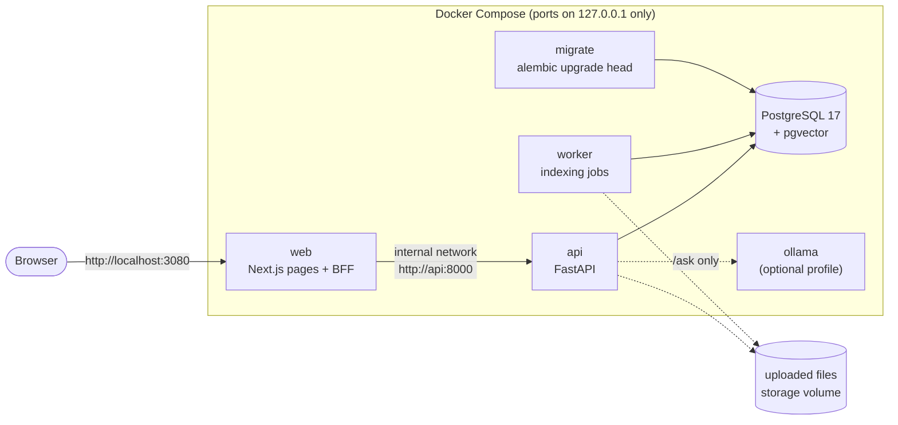

# DocMind

**Ask questions about your own documents and get answers that cite the exact passages, or an
honest "not enough evidence".** DocMind ingests PDF, DOCX and TXT files, indexes them with
multilingual embeddings in PostgreSQL + pgvector, and offers semantic search, hybrid search
and retrieval-augmented answers whose citations are verified by the server.

> **Status:** portfolio project, built phase by phase with tests and measured evaluations.
> It runs as a local, loopback-only Docker Compose stack. It is **not production-ready**: see
> [Known limitations](#known-limitations) and the [security audit](docs/phase-12-audit.md).

What makes it technically interesting:

- **Grounded RAG with abstention.** The model must cite passages it was shown; the server
  checks every citation, quote and number against the stored text and returns an
  abstention with a reason instead of an unverifiable answer.
- **Measured, not assumed.** Retrieval (Recall@k, Precision@k, MRR) and RAG behaviour are
  evaluated on labeled English, Russian and Kazakh sets; options that did not beat the
  baseline stayed opt-in. Results and their limits: [docs/guide.md](docs/guide.md#search-quality-evaluation).
- **Security-minded multi-user design.** Per-user isolation on every query, rotating refresh
  sessions with reuse detection, a backend-for-frontend that keeps refresh tokens out of
  JavaScript, and a recorded audit with fixed findings.
- **Operable.** PostgreSQL job queue with leases and retries, schema-aware readiness, JSON
  logs with request ids, hardened containers, backup and restore-drill tooling.

## Contents

[Features](#features) · [Architecture](#architecture) · [Tech stack](#tech-stack) ·
[Quick start](#quick-start-windows-powershell) · [Using the API](#using-the-api) ·
[Tests](#tests) · [Docker Compose](#docker-compose-stack) · [Security](#security) ·
[Known limitations](#known-limitations) · [Repository layout](#repository-layout) ·
[Documentation](#documentation)

## Features

**Backend and ingestion**
- FastAPI API (`/api/v1`) with one error envelope `{"error": {"code", "message", "details"}}`.
- Upload validation: type by extension and magic bytes, size limit enforced while streaming,
  SHA-256 duplicate detection, server-generated storage names, zip-bomb and page limits.
- Text extraction with page provenance (PyMuPDF, python-docx), token-aware chunking.
- Background indexing by a separate worker on a PostgreSQL job queue
  (`FOR UPDATE SKIP LOCKED`, leases, retries, heartbeat), statuses pending → processing →
  ready / failed.

**Retrieval and RAG**
- Embeddings with `intfloat/multilingual-e5-small` (model name and dimension stored with
  every vector); semantic search by cosine similarity in pgvector.
- Hybrid search: PostgreSQL full-text + vector, fused with Reciprocal Rank Fusion.
- `/ask`: bounded context, prompt-injection-aware prompt, replaceable generator (disabled,
  deterministic fake, or any OpenAI-compatible server such as Ollama with
  `qwen2.5:3b-instruct`), server-side citation, quote and number checks, abstention reasons.

**Security**
- Argon2id passwords; short-lived HS256 JWT access tokens with strict claim validation.
- Refresh-token sessions: opaque tokens stored as SHA-256, rotation, reuse detection that
  revokes the session, immediate revocation on logout, password change and deactivation.
- PostgreSQL-backed rate limits, security headers, trusted hosts, production config guards,
  logs without tokens, emails, query strings or document text.
- Next.js BFF: refresh token in an `HttpOnly; SameSite=Strict; Secure` cookie, access token
  in memory, CSRF origin checks, allowlisted API proxy, per-request nonce CSP.

**Web app** (Next.js 16, React 19, TypeScript, Tailwind CSS 4): sign-in and registration,
dashboard, documents with live indexing status, semantic and hybrid search, Ask with
citations and abstentions, account and sessions.

**Deployment and operations**
- Compose stack with PostgreSQL on an internal network (no published port), one-shot
  migrations, non-root read-only containers, loopback-only ports, optional Ollama profile.
- Backup, archive verification and restore drill (`scripts/db_backup.py`), a throwaway
  end-to-end release check and a failure drill that create no Docker volumes.
- CI workflow (lint, PostgreSQL tests, frontend, image builds, dependency audit); it has
  **not yet run on GitHub**.

## Architecture



Request path for a question: the API embeds the question, retrieves the user's passages
(semantic or hybrid), builds a token-bounded prompt, calls the generator, and accepts the
answer only if every citation names a passage it was given and every quote and number
appears in it. Details and trust boundaries: [docs/production-deployment.md](docs/production-deployment.md).

## Tech stack

| Area | Technologies |
|---|---|
| API | Python 3.13, FastAPI, Pydantic v2, pydantic-settings, Uvicorn |
| Data | PostgreSQL 17, pgvector, SQLAlchemy 2 (sync), Alembic, psycopg 3 |
| ML / retrieval | sentence-transformers, `intfloat/multilingual-e5-small`, PostgreSQL full-text search, RRF |
| Generation | OpenAI-compatible HTTP client (Ollama tested with `qwen2.5:3b-instruct`), deterministic fake |
| Parsing | PyMuPDF, python-docx |
| Auth | argon2-cffi, PyJWT |
| Web | Next.js 16, React 19, TypeScript (strict), Tailwind CSS 4 |
| Quality | pytest, Ruff, Vitest, Testing Library, ESLint, actionlint |
| Ops | Docker, Docker Compose, GitHub Actions (configured, not yet run) |

## Quick start (Windows PowerShell)

Prerequisites: Python 3.13, Docker Desktop, Node.js 24 (for the web app). Commands run in the
repository root unless noted.

```powershell
# 1. Python environment
python -m venv .venv
.\.venv\Scripts\Activate.ps1
pip install -e ".[dev,embeddings]"   # embeddings = sentence-transformers + PyTorch

# 2. Configuration and database (PostgreSQL in Docker, bound to 127.0.0.1)
Copy-Item .env.example .env          # set POSTGRES_PASSWORD and the same password in DOCMIND_DATABASE_URL
docker compose up -d postgres        # wait for "healthy": docker compose ps
alembic upgrade head                 # creates the schema and enables pgvector

# 3. API and indexing worker (two terminals, same venv)
uvicorn app.main:app --port 8001     # http://127.0.0.1:8001/api/v1/health/ready
python -m app.worker                 # downloads the embedding model on first start

# 4. Web app (third terminal)
cd frontend
npm ci --ignore-scripts
Copy-Item .env.example .env.local    # DOCMIND_API_URL=http://127.0.0.1:8001
npm run dev                          # open http://localhost:3000
```

Question answering needs a generator: set `DOCMIND_GENERATION_BACKEND=openai-compatible`
and an Ollama model (see [Question answering](docs/guide.md#question-answering-rag)).
Without one, `/ask` answers 503 and everything else works.

Configuration uses `DOCMIND_*` variables read by `app/core/config.py`; `.env.example`,
`frontend/.env.example` and `deploy/.env.example` contain placeholders only. The full table
is in [docs/guide.md](docs/guide.md#environment-variables). Never commit `.env` files.

## Using the API

Examples against the local API above (`$api = "http://127.0.0.1:8001/api/v1"`). Interactive
docs are at `/docs` outside production.

```powershell
$api = "http://127.0.0.1:8001/api/v1"
$cred = @{ email = "alice@example.com"; password = Read-Host "Password (12+ characters)" } | ConvertTo-Json
Invoke-RestMethod -Method Post "$api/auth/register" -ContentType "application/json" -Body $cred
$tokens = Invoke-RestMethod -Method Post "$api/auth/login" -ContentType "application/json" -Body $cred
$headers = @{ Authorization = "Bearer $($tokens.access_token)" }   # also: refresh_token, expires_in

# Upload (multipart field "file"); indexing runs in the worker
curl.exe -s -H "Authorization: Bearer $($tokens.access_token)" -F "file=@C:\path\to\report.pdf" "$api/documents"
Invoke-RestMethod "$api/documents" -Headers $headers               # status: pending/processing/ready/failed

# Semantic and hybrid search
$q = @{ query = "termination notice period"; top_k = 5 } | ConvertTo-Json
Invoke-RestMethod -Method Post "$api/search" -Headers $headers -ContentType "application/json" -Body $q
$h = @{ query = "termination notice period"; top_k = 5; mode = "hybrid" } | ConvertTo-Json
Invoke-RestMethod -Method Post "$api/search/hybrid" -Headers $headers -ContentType "application/json" -Body $h

# Ask: answer + citations, or abstained=true with abstention_reason
$a = @{ question = "What is the notice period?"; retrieval_mode = "semantic" } | ConvertTo-Json
Invoke-RestMethod -Method Post "$api/ask" -Headers $headers -ContentType "application/json" -Body $a

# Rotate and end the session
Invoke-RestMethod -Method Post "$api/auth/refresh" -ContentType "application/json" -Body (@{ refresh_token = $tokens.refresh_token } | ConvertTo-Json)
Invoke-RestMethod -Method Post "$api/auth/logout" -Headers $headers
```

Routes: `auth/register`, `auth/login`, `auth/refresh`, `auth/logout`, `auth/me`,
`auth/sessions`, `documents` (upload, list, detail, delete), `search`, `search/hybrid`,
`ask`, `health`, `health/ready`. Schemas, errors and scores are documented in
[docs/guide.md](docs/guide.md#documents-api).

## Tests

```powershell
# Backend: unit tests run without a database; integration tests need the *_test database
.\.venv\Scripts\Activate.ps1
ruff check .
$env:DOCMIND_TEST_DATABASE_URL = ((Get-Content .env | Select-String '^DOCMIND_DATABASE_URL=').Line -replace '^DOCMIND_DATABASE_URL=','').Trim() -replace '/docmind$','/docmind_test'
python -m pytest -q      # the suite refuses a database whose name does not end in _test

# Frontend
cd frontend
npm ci --ignore-scripts; npm audit; npm run lint; npm run typecheck; npm test; npm run build
```

Results measured locally for the current release are listed in
[docs/phase-12-audit.md](docs/phase-12-audit.md#commands-and-results-this-session-local).
Real-model tests (embedding model, Ollama) are opt-in: see [docs/guide.md](docs/guide.md#tests).

## Docker Compose stack

Two separate Compose setups, with separate project names and volumes:

| Setup | Files | Purpose |
|---|---|---|
| Development database | `docker-compose.yml` (project `docmind`) | PostgreSQL only, for the quick start above |
| Full stack | `deploy/compose.yaml` (project `docmind-stack`) | postgres, migrate, api, worker, web, optional ollama |

```powershell
Copy-Item deploy\.env.example deploy\.env     # generate secrets as in docs/production-deployment.md
docker compose -f deploy/compose.yaml --env-file deploy/.env up -d --build
docker compose -f deploy/compose.yaml --env-file deploy/.env ps
Start-Process http://localhost:3080           # web; the API is on 127.0.0.1:8080
docker compose -f deploy/compose.yaml --env-file deploy/.env down   # keeps the data volumes
```

- Disposable checks never touch these stacks: `scripts/smoke_test.py` with
  `deploy/compose.release-check.yaml` and `scripts/failure_drill.py` run under their own
  project names and create no Docker volumes.
- Backups: `python scripts/db_backup.py backup | verify | restore-drill` (custom-format
  `pg_dump`, checksum, archive check, restore into a throwaway container).
- Never use `docker compose down -v` on a stack whose data you want to keep.

Full procedures (secrets, model cache, upgrades, backup, restore to a new instance,
rollback, pre-release checklist): [docs/production-deployment.md](docs/production-deployment.md).

## Security

Controls are summarised under [Features](#features); design notes, threat model and the
session semantics are in [docs/deployment.md](docs/deployment.md) and
[docs/production-deployment.md](docs/production-deployment.md#trust-boundaries). The
[Phase 12 audit](docs/phase-12-audit.md) records the findings that were fixed (an open
redirect, unbounded BFF request bodies, readiness hanging on a frozen database, 500s during
outages), the residual risks and the release decision. To report a problem, see
[SECURITY.md](SECURITY.md).

## Known limitations

- **Not production-ready:** no TLS or reverse proxy, single host, no replication, no
  automated or off-site backups; restore-to-new-instance and cut-over are documented but
  not rehearsed end to end.
- **R1:** while PostgreSQL is frozen (not down), data requests wait until it resumes;
  readiness answers 503 within seconds.
- **R2:** behind the BFF the API sees one client address, so login, registration and
  refresh rate limits are shared by all users (safe against spoofing; one abuser can use up
  the budget). Fix: a reverse proxy that overwrites `X-Forwarded-For`.
- GitHub Actions are configured but have not run on GitHub yet.
- RAG quality was measured with one small local model on small synthetic sets; grounding
  checks verify citations, quotes and numbers, not that the answer follows from them.
- No email verification, password reset or MFA; registration is open.
- The secure session cookie works over plain HTTP only on `localhost`.

Roadmap (not started): TLS reverse proxy with a per-client rate-limit budget, a client-side
database timeout strategy for R1, conversation history, a stronger answer verifier,
cross-lingual retrieval evaluation.

## Repository layout

```text
app/            FastAPI app: api/v1 routers, core (config, security, logging), services,
                models, schemas, ingestion, embeddings, retrieval, rag, worker, admin, evaluation
alembic/        database migrations
frontend/       Next.js web app and BFF (own README)
deploy/         Compose stack, smoke and release-check overrides, env template
scripts/        smoke test, failure drill, backup tooling
tests/          pytest suite (unit + PostgreSQL integration)
docs/           guide, deployment, audit, phase plans, evaluation results
requirements/   hash-locked dependency sets for containers and CI
```

## Documentation

| Document | Contents |
|---|---|
| [docs/guide.md](docs/guide.md) | Full reference: configuration, every API, indexing, search, RAG, evaluations, tests |
| [frontend/README.md](frontend/README.md) | Web app, BFF authentication design, frontend tests |
| [docs/deployment.md](docs/deployment.md) | Sessions, rate limits, logs, health, CI (Phase 9) |
| [docs/production-deployment.md](docs/production-deployment.md) | Compose deployment, backup and recovery, release checklist, rollback |
| [docs/phase-12-audit.md](docs/phase-12-audit.md) | Security and release audit, residual risks, decision |
| [docs/phase-10-plan.md](docs/phase-10-plan.md), [docs/phase-11-plan.md](docs/phase-11-plan.md) | Frontend and deployment plans |

## License

No license has been chosen yet, so all rights are reserved by default. Note for a future
choice: PyMuPDF, used for PDF parsing, is licensed under AGPL-3.0.
