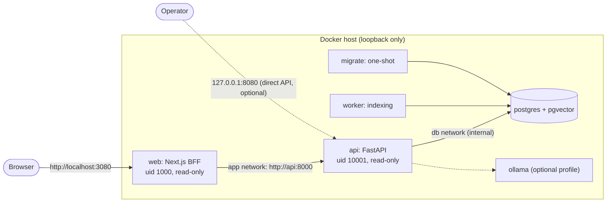

# Phase 11 plan: deployment and release readiness

Status: written after a read-only audit of `phase-10-frontend` at `d590f17` (7 commits on top
of `phase-9-production-readiness` at `047c062`, no divergence). Work happens on
`phase-11-deployment-readiness`. Scope: a reproducible, local, production-style deployment
and a release review. Not a public deployment: no cloud, DNS, TLS, registry or push.

Tools found: Docker 29.9.2, Compose 5.6.1, Node 24.22.1, npm 11.19.1, Python 3.13.14.

## Current architecture (verified)

- `deploy/compose.yaml` (project `docmind-stack`): `postgres` (pgvector, digest-pinned, only
  on the internal `db` network, no published port), one-shot `migrate`
  (`alembic upgrade head`), `api` (published on `127.0.0.1:8080`, readiness healthcheck),
  `worker` (heartbeat healthcheck), optional `ollama` profile. App containers: non-root uid
  10001, read-only root fs, tmpfs `/tmp`, `cap_drop: ALL`, `no-new-privileges`.
- `deploy/compose.smoke.yaml` + `scripts/smoke_test.py`: the isolated `docmind-smoke` project
  (its volumes hold earlier test data and must not be touched in this phase).
- The frontend (`frontend/`, Next.js 16 BFF) runs only with `npm run dev` / `npm start`; it
  is not containerized and not in Compose.
- CI: lint, PostgreSQL tests, frontend (lint, types, tests, audit, build), Docker build of the
  backend image with Compose validation, advisory pip-audit. Never run on GitHub so far.

## Target architecture

- New `web` service built from `frontend/Dockerfile` (Next.js `output: "standalone"`,
  `node:24.22.1-bookworm-slim` pinned by digest, `npm ci --ignore-scripts` from the lock
  file, non-root, read-only root fs with tmpfs for `.next/cache` and `/tmp`).
- `web` reaches the API on a new internal `app` network as `http://api:8000`; the API must
  accept the `api` Host header (`DOCMIND_ALLOWED_HOSTS` gets `api`).
- Published ports stay on 127.0.0.1: web on `DOCMIND_WEB_PORT` (default 3080, so it does not
  clash with `npm run dev` on 3000); the API port stays for operators and the smoke test.
- `HOSTNAME=0.0.0.0` for the Next.js standalone server (Docker sets `HOSTNAME` to the
  container id, and the server listens on it).
- `init: true` for `web` so signals reach Node correctly; Next.js drains in-flight requests
  on SIGTERM.

## Trust boundaries and threat assumptions

- The only entry points are loopback ports. Anything beyond the host needs an HTTPS reverse
  proxy that is not part of this phase.
- Browser to `web`: same origin; refresh token in an HttpOnly, SameSite=Strict, Secure
  cookie (Secure is accepted by browsers on `http://localhost`); CSRF checks on the cookie
  routes; per-request nonce CSP.
- `web` to `api`: internal network; Bearer tokens forwarded unchanged; no secrets in `web`.
- Client address: the API trusts `X-Forwarded-For` only from `DOCMIND_TRUSTED_PROXIES`
  (empty), and the BFF does not forward it (`DOCMIND_BFF_FORWARD_CLIENT_IP=false`). So rate
  limits see one address (the `web` container) for every browser: a shared budget. Safe
  against spoofing; one abuser can exhaust login attempts for everyone. Fixing that needs a
  trusted reverse proxy that sets the header, which is out of scope and documented.
- Assumed trusted: the Docker host and its operator, the images built here. Not defended:
  a compromised host, a malicious operator, denial of service from many addresses.

## Release gates

1. Backend: `ruff check .`, full `pytest` against the isolated `docmind_test` database
   (target proven before running).
2. Frontend: `npm ci --ignore-scripts`, `npm audit`, lint, typecheck, tests, build.
3. Configuration tests: Compose invariants checked by pytest (no PostgreSQL port, loopback
   binds, hardening options, BFF forwarding off, internal networks).
4. `docker compose config` for the base, smoke and release-check files.
5. Images build locally (backend and web); nothing is pushed.
6. End-to-end on a fresh, uniquely named project with no named volumes
   (`deploy/compose.release-check.yaml`): the existing smoke checks plus checks through the
   `web` container.
7. Backup tooling: unit-tested; the existing backup archive validated read-only; restore
   drill only into a throwaway container on tmpfs.
8. `actionlint` (binary from Phase 9, not reinstalled), `git diff --check`.

## Test strategy and isolation

- Never the dev database (`docmind` on 127.0.0.1:5440), never `docmind-smoke_*` or
  `docmind_docmind_pgdata` volumes, never `down -v` or prune.
- The release check uses project `docmind-relcheck`: PostgreSQL data on tmpfs, uploads in a
  bind-mounted scratch directory, the host model cache mounted read-only, other ports. No
  Docker volumes are created, so `down` (without `-v`) leaves nothing behind but the
  scratch directory.
- Restore drill: a `--rm` container with its data directory on tmpfs and a unique name.

## Rollback strategy

- Application rollback: rebuild or retag the previous image and `up -d`; data stays.
- Database: migrations are never downgraded casually. Roll back by restoring the last
  verified backup into a new instance, checking it, then cutting over; the old volume stays
  until the new one is verified.

## Known limitations (expected after this phase)

- No TLS, no reverse proxy, single host, no replication or automated backups.
- Shared rate-limit budget behind the BFF (above).
- Secure cookies over plain HTTP work only on localhost.
- CI has not run on GitHub; local results only.
- Ollama image runs as root (upstream) and is not part of default startup.
