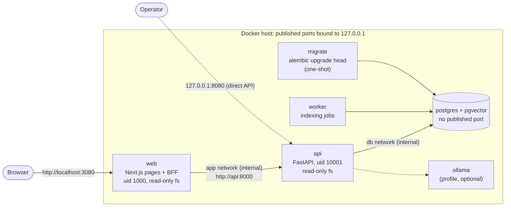

# DocMind production-style deployment (Phase 11)

A single-host Docker Compose deployment of the whole product: web app, API, indexing
worker and PostgreSQL. Everything listens on 127.0.0.1 only. It is release-ready for local
or private evaluation; it is **not** an internet deployment: that needs HTTPS in front, a
host you control, monitoring and the review items at the end. Phase 9 details (sessions,
rate limits, logs, CI) remain in [deployment.md](deployment.md).

## Architecture



| Service | Image | Published | Networks | Starts after |
|---|---|---|---|---|
| `postgres` | `pgvector/pgvector:pg17@sha256:ac08…` | never | `db` (internal) | — |
| `migrate` | `docmind:local` | — | `db`, `egress` | postgres healthy |
| `api` | `docmind:local` | `127.0.0.1:${DOCMIND_API_PORT:-8080}` | `db`, `egress`, `app` | migrate exited 0 |
| `worker` | `docmind:local` | — | `db`, `egress` | migrate exited 0 |
| `web` | `docmind-web:local` | `127.0.0.1:${DOCMIND_WEB_PORT:-3080}` | `app` (internal), `edge` | api healthy |
| `ollama` | `ollama/ollama:0.40.11@sha256:dea7…` | never | `db`, `egress` | profile `ollama` only |

Project name `docmind-stack`, volumes `docmind-stack_pgdata`, `_storage`, `_hf-cache`,
`_ollama-models`. Separate from the development database (root `docker-compose.yml`,
project `docmind`) and from the smoke test (`docmind-smoke`).

## Trust boundaries

| Boundary | What protects it |
|---|---|
| Network → host | Only loopback ports. No public listener, no reverse proxy in this phase. |
| Browser → web | Same origin. Refresh token in an `HttpOnly; SameSite=Strict; Secure; Path=/bff/auth` cookie, access token in memory only. Cookie routes require a same-origin `Origin` and a JSON body (CSRF). Per-request nonce CSP, `X-Frame-Options: DENY`, `nosniff`, no referrer. Document text and model output rendered as text. |
| web → api | Internal `app` network. Only allowlisted routes are proxied; token endpoints are not. The web container holds no backend secret. |
| api → postgres | Internal `db` network, password from `deploy/.env`. |
| Client address | The API believes `X-Forwarded-For` only from `DOCMIND_TRUSTED_PROXIES` (empty), and web never forwards it (`DOCMIND_BFF_FORWARD_CLIENT_IP` is fixed to `false` in Compose). |
| Containers | Non-root, read-only root fs, `cap_drop: ALL`, `no-new-privileges`, no Docker socket, base images pinned by digest, dependencies from lock files. |

Consequence of the client-address rule: the API sees the `web` container's address for
every browser, so login and registration rate limits are **shared by all users**. That
cannot be spoofed, but one abuser can exhaust the budget for everyone. A per-user budget
needs a reverse proxy that overwrites `X-Forwarded-For`, then
`DOCMIND_BFF_FORWARD_CLIENT_IP=true` on web and the web container's address in the API's
`DOCMIND_TRUSTED_PROXIES`. Never enable it without such a proxy: Next.js passes a
client-supplied header through.

The `Secure` cookie flag is always on in the container (`NODE_ENV=production`). Browsers
accept Secure cookies over plain HTTP only on `localhost`, so open
**http://localhost:3080**; any other host name needs HTTPS.

Assumed trusted: the host, its operator and the images built from this repository. Not
defended: a compromised host, many-address denial of service, a stolen `deploy/.env`.

## Configuration

`deploy/.env` (git-ignored, never committed) from the template:

```powershell
Copy-Item deploy\.env.example deploy\.env
# Generate each secret without displaying it, straight into the file:
$b = New-Object byte[] 48; [Security.Cryptography.RandomNumberGenerator]::Create().GetBytes($b)
(Get-Content deploy\.env) -replace '^POSTGRES_PASSWORD=.*', ('POSTGRES_PASSWORD=' + [Convert]::ToBase64String($b).Replace('+','-').Replace('/','_').TrimEnd('=')) | Set-Content deploy\.env
$b = New-Object byte[] 48; [Security.Cryptography.RandomNumberGenerator]::Create().GetBytes($b)
(Get-Content deploy\.env) -replace '^DOCMIND_JWT_SECRET_KEY=.*', ('DOCMIND_JWT_SECRET_KEY=' + [Convert]::ToBase64String($b)) | Set-Content deploy\.env
Remove-Variable b
```

The PostgreSQL password is made URL-safe because it goes into the database URL. Restrict
the file to your account if the machine is shared:
`icacls deploy\.env /inheritance:r /grant:r "$($env:USERNAME):(R,W)"`.

| Variable | Default | Notes |
|---|---|---|
| `POSTGRES_PASSWORD` | — (required) | Compose refuses to start without it |
| `DOCMIND_JWT_SECRET_KEY` | — (required) | ≥ 32 bytes; the API refuses to start in prod otherwise; rotating it ends every session |
| `DOCMIND_ENVIRONMENT` | `prod` | prod refuses debug, missing/`*` allowed hosts, CORS `*`, the fake embedder and generator |
| `DOCMIND_ALLOWED_HOSTS` | `localhost,127.0.0.1` | Compose always prepends `api` (the web container's Host header) |
| `DOCMIND_TRUSTED_PROXIES` | empty | Leave empty without a trusted reverse proxy |
| `DOCMIND_API_PORT` / `DOCMIND_WEB_PORT` | `8080` / `3080` | Loopback ports |
| `DOCMIND_GENERATION_BACKEND` | `disabled` | `openai-compatible` + `DOCMIND_GENERATION_BASE_URL` for Ollama |
| `DOCMIND_EMBEDDING_ALLOW_DOWNLOAD` / `HF_HUB_OFFLINE` | `false` / `1` | Allow once to fill the model cache (below) |

CORS stays off: the browser only talks to the web origin. The web container's own settings
are fixed in Compose (`DOCMIND_API_URL=http://api:8000`, forwarding off); `DOCMIND_API_URL`
is read on the server at run time and is not in the client bundles (checked in CI).

## Build, start, check, stop

```powershell
cd C:\Users\Erasyl\Desktop\DocMind
docker compose -f deploy/compose.yaml --env-file deploy/.env build
docker compose -f deploy/compose.yaml --env-file deploy/.env up -d
docker compose -f deploy/compose.yaml --env-file deploy/.env ps        # all healthy, migrate exited (0)
Invoke-RestMethod http://127.0.0.1:8080/api/v1/health/ready           # status ready, database ok, schema ok
Start-Process http://localhost:3080
```

First start only, to put the embedding model (about 470 MB) into the `hf-cache` volume:
set `DOCMIND_EMBEDDING_ALLOW_DOWNLOAD=true` and `HF_HUB_OFFLINE=0` in `deploy/.env`, start,
upload one document and wait until it is ready, then set them back and
`up -d` again. Without the model, uploads stay queued and search answers 503
`embedding_unavailable`; readiness is not affected (it never loads the model).

```powershell
# logs (JSON lines for api and worker; filter by request id)
docker compose -f deploy/compose.yaml --env-file deploy/.env logs -f api worker web
docker compose -f deploy/compose.yaml --env-file deploy/.env logs api | Select-String '"request_id": "<id>"'
# stop: containers stay, data stays
docker compose -f deploy/compose.yaml --env-file deploy/.env stop
# remove containers and networks, KEEP volumes (never add -v unless you mean to delete the data)
docker compose -f deploy/compose.yaml --env-file deploy/.env down
```

Optional local LLM: `--profile ollama` with `DOCMIND_GENERATION_BACKEND=openai-compatible`
and `DOCMIND_GENERATION_BASE_URL=http://ollama:11434/v1`, then
`docker compose -f deploy/compose.yaml --env-file deploy/.env exec ollama ollama pull qwen2.5:3b-instruct`
(the image is about 8.4 GB and the model 1.9 GB; neither is needed for search).

## Health, failure modes, shutdown

| Check | Meaning | Used by |
|---|---|---|
| `GET /api/v1/health` | API process alive; touches nothing | image default |
| `GET /api/v1/health/ready` | database reachable and schema at the code's Alembic head (503 otherwise) | `api` healthcheck, `web` start condition |
| `python -m app.worker healthcheck --max-age 60` | worker heartbeat file fresh | `worker` healthcheck |
| `GET /login` on web | Next.js server answers | `web` healthcheck |

| Failure | Effect |
|---|---|
| PostgreSQL down | `/health` 200, `/health/ready` 503, data calls 503 `database_unavailable`; web pages load, sign-in reports the outage |
| Worker down | API ready; uploads stay `pending` and are indexed when a worker returns; a job interrupted by a crash is reclaimed after `DOCMIND_JOB_LEASE_TIMEOUT_S` |
| Model cache empty | search and indexing 503 / failed jobs with `embedding_unavailable`; readiness unaffected |
| LLM unavailable | only `/ask` answers 503 `generation_unavailable`; the Ask page says so, search keeps working |
| API down | web pages load; data calls fail with "temporarily unavailable"; web stays healthy (its check does not depend on the API) |

Shutdown: `docker compose stop` sends SIGTERM. uvicorn drains for up to 20 s
(`stop_grace_period` 30 s), the worker finishes the current job (60 s), Next.js drains
in-flight requests (20 s; measured 0.2 s to exit when idle, exit code 143). `restart:
unless-stopped` restarts crashed services with Docker's increasing back-off; a worker that
finds an outdated schema exits with code 3 and would be restarted the same way, which in
normal operation cannot happen because it starts only after `migrate` succeeded.

Logs never contain passwords, tokens, emails, `Authorization` headers, query strings,
document text or exception messages (checked by the smoke tests). Every response carries
`X-Request-ID`; quote it when reporting a problem.

## Migrations and upgrades

`migrate` runs `alembic upgrade head` once per `up`; `api` and `worker` start only after it
exits 0 and both refuse an outdated schema. An upgrade is therefore:

```powershell
git pull                                                    # or check out the release tag
python scripts/db_backup.py backup --container docmind-stack-postgres-1 --label docmind-stack
docker compose -f deploy/compose.yaml --env-file deploy/.env build
docker compose -f deploy/compose.yaml --env-file deploy/.env up -d   # migrate runs first
docker compose -f deploy/compose.yaml --env-file deploy/.env ps
```

Read new migrations before upgrading (`alembic upgrade head --sql` in the dev
environment). A failed migration leaves api and worker stopped and the old data in place.

## Backup and recovery

`scripts/db_backup.py` (Python from the repository's `.venv`; needs only Docker):

```powershell
# backup of the deployment stack (dev stack: --container docmind-postgres --label docmind-dev)
.\.venv\Scripts\python.exe scripts\db_backup.py backup --container docmind-stack-postgres-1 --label docmind-stack
# -> %USERPROFILE%\.docmind\backups\docmind-stack-<UTC time>-rev<alembic>.dump  + .sha256
# read-only check of any archive
.\.venv\Scripts\python.exe scripts\db_backup.py verify "$env:USERPROFILE\.docmind\backups\<file>.dump"
# rehearsal: restore into a throwaway container (tmpfs, no network), print row counts only
.\.venv\Scripts\python.exe scripts\db_backup.py restore-drill "$env:USERPROFILE\.docmind\backups\<file>.dump"
```

- `backup` never overwrites a file, compares the checksum of the copy with the dump inside
  the container, checks the archive with `pg_restore --list` and writes a `.sha256` file.
- The dump holds every account, password hash, session and document text. Keep it as
  private as the database: on an encrypted disk (BitLocker) or encrypted with a tool you
  trust before it leaves the machine; restrict the folder to your account
  (`icacls "$env:USERPROFILE\.docmind\backups" /inheritance:r /grant:r "$($env:USERNAME):(OI)(CI)F"`).
- Uploaded originals live in the `storage` volume, not in the dump. Back it up at the
  same time (with the stack stopped for a consistent pair):
  `docker run --rm -v docmind-stack_storage:/data:ro -v "$env:USERPROFILE\.docmind\backups:/out" alpine tar czf /out/storage-<time>.tgz -C /data .`
- Retention: keep at least the last 7 daily and 4 weekly backups, and always the one taken
  right before an upgrade; delete older ones deliberately, never automatically from here.
- Run `restore-drill` after every backup you intend to rely on. It checks that the archive
  restores and shows per-table counts and the schema revision, never row contents.

### Recovery (restore to a new instance, then cut over)

Never restore over a live database, and never downgrade migrations as a rollback.

```powershell
# 1. new, empty stack under another project name: its own volumes, old data untouched
docker compose -p docmind-restore -f deploy/compose.yaml --env-file deploy/.env up -d postgres
# 2. restore into it (the new database is empty: pg_restore without --clean)
Get-Content -AsByteStream -Raw "<file>.dump" | docker exec -i docmind-restore-postgres-1 pg_restore -U docmind -d docmind --no-owner --exit-on-error   # PowerShell 7
#    Windows PowerShell 5.1: docker cp "<file>.dump" docmind-restore-postgres-1:/tmp/r.dump, then
#    docker exec docmind-restore-postgres-1 pg_restore -U docmind -d docmind --no-owner --exit-on-error /tmp/r.dump
# 3. restore the storage archive into docmind-restore_storage the same way (tar xzf)
# 4. verify: row counts and revision (counts only), then start the rest of the new stack
docker exec docmind-restore-postgres-1 psql -U docmind -d docmind -At -c "select version_num from alembic_version"
# 5. cut over: stop the old stack (keep its volumes), start the new one on the same ports
docker compose -f deploy/compose.yaml --env-file deploy/.env stop
docker compose -p docmind-restore -f deploy/compose.yaml --env-file deploy/.env up -d
```

The old volumes stay until the new instance has been in use and verified. The restored
schema may be older than the code: `migrate` then upgrades it, which is why the backup
taken before an upgrade is the rollback point.

## Throwaway release check

The full end-to-end suite on a stack that creates **no Docker volumes** (PostgreSQL on
tmpfs, uploads in a directory you choose, the host model cache read-only), removed at the
end with `down` (never `-v`):

```powershell
$work = "$env:TEMP\docmind-relcheck-$(Get-Date -Format yyyyMMddHHmmss)"
.\.venv\Scripts\python.exe scripts\smoke_test.py --project docmind-relcheck --override compose.release-check.yaml `
  --port 8281 --web-port 3281 --storage-dir "$work\storage" --env-file "$work\relcheck.env" --down
```

It needs the embedding model in `%USERPROFILE%\.cache\huggingface\hub`. 31 checks: stack
and migrations, readiness, the web container (nonce CSP, sign-in through the BFF over the
internal API URL, cookie flags, CSRF refusal, proxy allowlist, cookie rotation, sign-out),
two-user isolation of documents, search and Ask, refresh rotation and reuse revocation,
logout, rate limiting, restarts, a SIGKILLed job being reclaimed, leak-free JSON logs.

## Pre-release checklist

- [ ] On a clean checkout of the release commit: `git status` clean except known local files.
- [ ] Backend: `.\.venv\Scripts\ruff.exe check .` and `python -m pytest` with
      `DOCMIND_TEST_DATABASE_URL` pointing at a `*_test` database.
- [ ] Frontend (`cd frontend`): `npm ci --ignore-scripts`, `npm audit --audit-level=high`,
      `npm run lint`, `npm run typecheck`, `npm test`, `npm run build`.
- [ ] Dependency audit: `pip-audit` on both lock files (see deployment.md); torch advisories
      by hand.
- [ ] `docker compose ... config --quiet` for compose.yaml (+ smoke, + release-check).
- [ ] Both images build; `docker run --rm --entrypoint id docmind:local -u` = 10001,
      `docmind-web:local` = 1000.
- [ ] Throwaway release check: 31/31.
- [ ] Fresh backup of the target stack + `verify` + `restore-drill`.
- [ ] New migrations read; `deploy/.env` reviewed (prod, secrets set, no trusted proxies).
- [ ] GitHub Actions green on the release commit (not yet run for this repository).
- [ ] Release notes list migrations and any manual steps.

## Rollback

1. Application only (no migration in the release): check out the previous release,
   `build`, `up -d`. Data is untouched.
2. Release with migrations: do **not** run `alembic downgrade` on live data. Restore the
   pre-upgrade backup into a new instance (above), start the previous release against it,
   verify, cut over. Writes made after the backup are lost unless re-applied; say so in the
   incident notes.
3. Keep the failed instance's volumes until the post-mortem is done.

## Known limitations and manual review items

- No TLS, no reverse proxy, single host, no replication, no automated or off-site backups.
- Shared rate-limit budget behind the web container (see trust boundaries).
- Secure cookies over plain HTTP work on `localhost` only.
- The `egress` network gives api/worker/migrate outbound access (model downloads, remote
  LLM); `edge` gives web outbound access as a side effect of publishing its port.
- The Ollama image runs as root and has no GPU configuration.
- Images: backend about 2 GB (PyTorch CPU), web about 390 MB.
- Review before any wider deployment: TLS termination and proxy header handling, secrets
  storage beyond a file, backup encryption and off-site copies, monitoring and alerting,
  log retention, registration policy (open sign-up), and the items in deployment.md.
